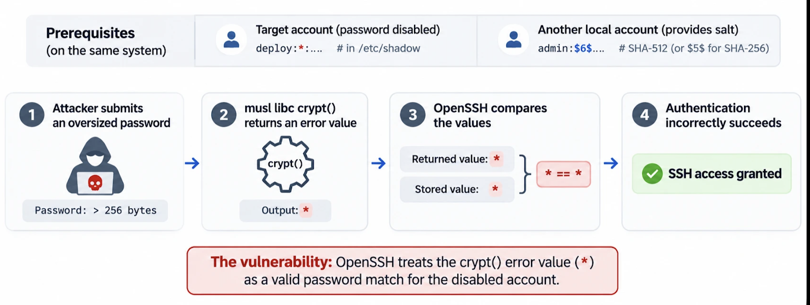

Según Previdian , los ciberdelincuentes están intentando explotar una vulnerabilidad de seguridad recientemente descubierta que afecta a OpenSSH y que permite iniciar sesión en cuentas que no tienen contraseña .

La vulnerabilidad, identificada como CVE-2026-123158 (puntuación CVSS: 8,1) y con nombre en clave SSHole (o *sshole), afecta a los sistemas Linux que ejecutan OpenSSH en la biblioteca C musl con los módulos de autenticación conectables (PAM) deshabilitados, incluida la configuración predeterminada del servidor OpenSSH de Alpine Linux.

Un atacante no autenticado puede proporcionar una contraseña demasiado larga para acceder a cuentas configuradas deliberadamente sin contraseñas válidas, sin necesidad de robar credenciales ni claves SSH. Este problema, descubierto por el investigador de seguridad Ozgun Kultekin, se ha solucionado en OpenSSH 10.6p2 .

El problema subyacente se remonta a un parche introducido en 2016 para corregir una vulnerabilidad de enumeración de nombres de usuario identificada como CVE-2016-6210 . En determinadas condiciones, el comportamiento de gestión de contraseñas en OpenSSH interpreta erróneamente una operación de hash de contraseña fallida como una autenticación exitosa, al producir el mismo valor ("*") utilizado para indicar que una cuenta tiene la contraseña deshabilitada a nivel del sistema.

Un atacante puede aprovechar la vulnerabilidad para autenticarse en ciertas cuentas sin contraseña utilizando una contraseña arbitraria de entre 257 y 1024 bytes, lo que provoca que el intento de hash falle y devuelva un asterisco. El demonio sshd compara entonces la contraseña con el asterisco almacenado en el campo de contraseña de la cuenta, lo que permite un inicio de sesión exitoso.

Para mayor claridad, la explotación exitosa requiere al menos una cuenta con un asterisco (*) como hash de contraseña. No permite a los atacantes eludir las contraseñas en cuentas con hashes de contraseña válidos.

«Un ataque SSHole exitoso otorga acceso con los permisos existentes de la cuenta comprometida», afirmó Safe Security . «Para las empresas, las consecuencias de SSHole dependen de los privilegios de la cuenta comprometida».

"Si bien el acceso SSH no autorizado es la consecuencia inmediata, los atacantes también pueden obtener acceso a las credenciales de implementación, los secretos de las aplicaciones y la infraestructura conectada, lo que podría permitir el movimiento lateral o la interrupción del servicio."

Cabe destacar que la vulnerabilidad no afecta a Dropbear, a las distribuciones de Linux basadas en glibc, a los sistemas que no son Linux ni a los sistemas que verifican las contraseñas mediante PAM.

La empresa de inteligencia sobre amenazas Previdian afirmó haber detectado el primer intento de explotación menos de nueve horas después de la publicación de la vulnerabilidad CVE, y añadió que confirmó el acceso de administrador a un honeypot que ejecutaba Alpine Linux y OpenSSH. Los datos de telemetría muestran un total de ocho intentos de explotación desde una dirección IP geolocalizada en Japón.

"La dirección IP de origen observada, 89.116.89[.]18, utilizó contraseñas demasiado largas para eludir la autenticación y ejecutó comandos de reconocimiento, incluidos id, uname y hostname, a través de sesiones SSH no interactivas", dijo Ryan Dewhurst, fundador y director ejecutivo de Previdian, en un comunicado compartido con The Hacker News.

Se recomienda a los usuarios afectados que instalen OpenSSH 10.6p2 o el paquete parcheado de su distribución y, a continuación, reinicien sshd. Alpine también recomienda que los usuarios investiguen las entradas de registro de "Contraseña aceptada para" relacionadas con cuentas que no deberían aceptar inicios de sesión con contraseña.

«Busque en /var/log/messages líneas de sshd que digan "Contraseña aceptada" para una cuenta que no tiene contraseña (alpine, root o cualquier usuario que solo tenga clave)», dijo Alpine . «Revise el uso de doas y los usuarios, archivos y claves autorizadas creados recientemente en las máquinas expuestas. Si no puede descartar un inicio de sesión, considere que la máquina está comprometida».

### Actualizar

A fecha de 8 de noviembre de 2026, el número de intentos de explotación ha aumentado a 20 y se originaron desde 13 direcciones IP únicas de Dinamarca, Irán, Japón, Países Bajos, Noruega, Singapur, Suecia, Suiza y Estados Unidos.

